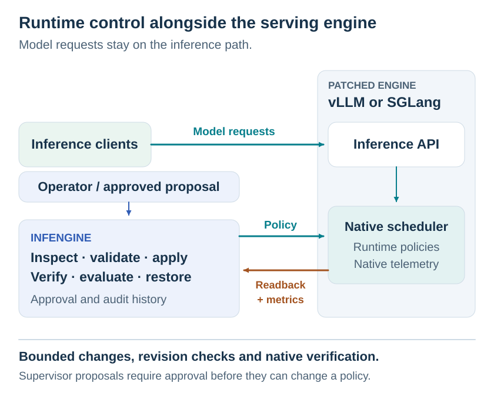
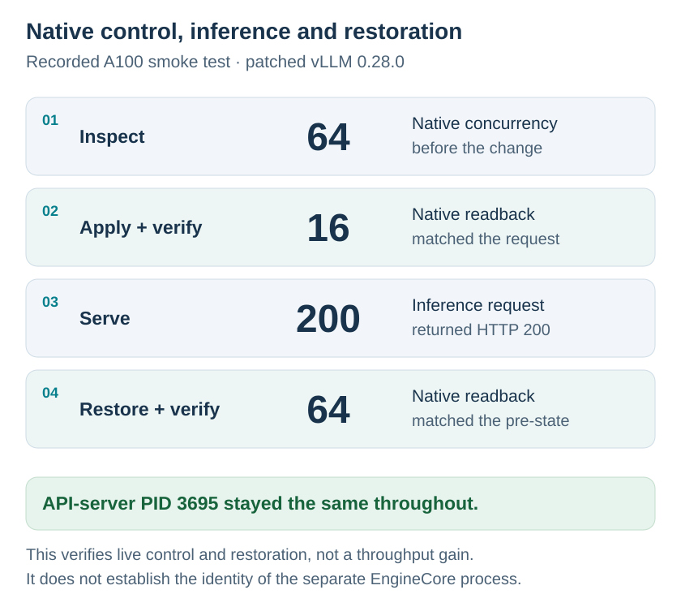
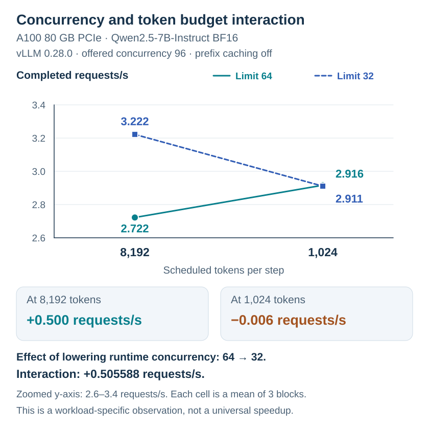

# InfEngine

**Inspect, change and verify live inference policies. Measure the trade-offs before choosing a configuration.**

**InfEngine** is an open-source control and evaluation layer for patched **vLLM** and **SGLang**. It helps inference engineers inspect live scheduler settings, make bounded changes, verify what the engine actually applied, compare workload outcomes, and restore recorded policies. Model requests continue to flow directly to the serving engine; InfEngine is not an inference proxy.

[Read the engineering case study](https://puristan.com/posts/infengine-runtime-control/) · [Get started](docs/QUICKSTART.md) · [Architecture](docs/ARCHITECTURE.md) · [Supported controls](docs/CONTROL_REFERENCE.md)

**Status:** v0.1.0 research/pilot. Live control requires patched **vLLM 0.28.0** or **SGLang 0.5.18**; arbitrary unmodified releases are not supported.

## Why live policy changes need verification

A model server that performs well with short chat requests can behave very differently when longer prompts, document-processing tasks, or bursts of concurrent users arrive. The engineer must decide whether to change the concurrency limit, the amount of work scheduled per step, or another admission rule. **The same change can improve throughput and worsen time to first token**—or have almost no effect because another constraint is already limiting the scheduler.

A successful configuration API response does not answer the operational question. We need to know that the *native running scheduler* changed, what happened to performance under a defined workload, and whether the previous policy can be restored. InfEngine brings these steps together without claiming to choose an optimal configuration automatically.

## When to use InfEngine

| Scenario | InfEngine provides |
|---|---|
| **Investigate rising latency or queues** | Inspect the engine's actual runtime policy, supported controls, current limits and telemetry quality. |
| **Test a different scheduling policy** | Apply a bounded change and verify it through native readback, without reloading the model. |
| **Compare alternatives under load** | Run an explicit baseline/candidate experiment with recorded throughput, latency, queueing and incomplete work where available. |
| **Adjust several controls** | Validate the complete policy, apply it against an expected revision, and report verification or partial recovery. |
| **Keep changes reviewable** | Require human approval where appropriate, record the actor and outcome, and restore settings from a recorded pre-state. |

## Architecture

Inference requests still go directly to vLLM or SGLang. InfEngine communicates through the supported native control integration and collects evidence outside the inference request path. An observe-only supervisor can **propose** a change for human approval. Authenticated operators can also apply policies directly, or launch an explicit evaluation. Restoration is a verified operation; it cannot undo all prior side effects.

<picture>
  <source media="(max-width: 600px)" srcset="docs/assets/readme/infengine_architecture_mobile.svg">
  
</picture>

Policies are revision-bound and checked against native limits. vLLM applies a coordinated multi-field request; SGLang applies fields sequentially. Neither provides an engine-atomic transaction. The reconciler reports convergence or recovery outcomes, and the audit history records the actor and pre/post state.

[Read the architecture and failure semantics](docs/ARCHITECTURE.md)

## Verified control and measured performance

We separate two questions: **Did the configuration change reach the running engine?** and **Did that change improve the workload's performance?** A reliable control path is necessary, but it cannot establish a performance benefit on its own.

### Native control and inference continuity

In an A100 smoke test on patched vLLM 0.28.0, we inspected the runtime concurrency limit (**64**), changed it to **16**, verified the native value, completed an inference request successfully, and restored **64**. The API-server process ID remained **3695** during the recorded sequence.

<picture>
  <source media="(max-width: 600px)" srcset="docs/assets/readme/live_control_verification_mobile.svg">
  
</picture>

**What this establishes:** verified live policy change, functioning inference and restoration without restarting the identified API server. It does **not** measure a throughput gain or establish the identity of vLLM's separate EngineCore process.

### Concurrency and token budget interaction

We then evaluated actual scheduling behavior. In one **A100 80 GB PCIe / Qwen2.5-7B-Instruct BF16** experiment, we tested **two concurrency limits (64 and 32)** against **two per-step token budgets (8,192 and 1,024)**. Prefix caching was disabled to avoid contamination between experimental phases; each of the four combinations was measured in three interleaved blocks, with offered concurrency 96 and 60-second measurement windows. CUDA graphs remained enabled.

<picture>
  <source media="(max-width: 600px)" srcset="docs/assets/readme/concurrency_token_interaction_mobile.svg">
  
</picture>

The concurrency effect depended on the token budget:

| Scheduled tokens per step | Requests/s at concurrency 64 → 32 | Change |
|---|---|---|
| 8,192 | 2.722 → 3.222 | +0.500 requests/s |
| 1,024 | 2.916 → 2.911 | −0.006 requests/s |

The difference between these two effects was **+0.505588 requests/s**. These are cell means across three blocks, rounded for display; the chart uses a zoomed y-axis. At the lower token budget, the means of block-level TTFT p95 estimates were about **39 seconds**, compared with **19–19.5 seconds** at the higher budget. Those summaries are not pooled request percentiles. The [factorial summary](https://puristan.com/posts/infengine-runtime-control/assets/data/2x2_summary.json) and [per-block measurements](https://puristan.com/posts/infengine-runtime-control/assets/data/2x2_per_block.csv) provide the underlying numbers.

**Why this matters:** changing one knob without controlling the others can lead to a misleading recommendation. These are workload-specific measurements, not an InfEngine speedup claim or a universal tuning rule. The [full technical article](https://puristan.com/posts/infengine-runtime-control/) includes the earlier prefix-cache confound, latency trade-offs, all experimental figures and downloadable measurements.

## Initial supported controls

InfEngine deliberately started with **runtime scheduling and admission policy** that could be changed inside resources provisioned when the model server launched. It does not dynamically change tensor parallelism, model weights, KV cache allocation size or CUDA graph provisioning.

### Patched vLLM 0.28.0

| HOT control | What changes and where it is bounded |
|---|---|
| `runtime_concurrency` | Running-request admission ceiling, from 1 through provisioned `max_num_seqs`. Other admission gates can bind first. |
| `runtime_max_scheduled_tokens` | Total prefill **and** decode tokens scheduled per step, within the provisioned token ceiling. Not a request's output length. |
| `long_prefill_token_threshold` | Per-prompt long-prefill allowance within a step. Nonnegative integer; zero disables this restriction. |
| `runtime_kv_watermark` | Admission headroom as a fraction of existing KV blocks, in `[0.0, 1.0)`. Does not resize the KV pool. |
| `runtime_reserve_full_isl` | Boolean: reserve KV for the complete input or allow chunked input admission. Applies to future admissions. |

### Patched SGLang 0.5.18

| HOT control | What changes and where it is bounded |
|---|---|
| `runtime_concurrency` | Per-rank running-request ceiling, from 1 through provisioned `max_running_requests`; also limited by request-token pool slots. Validated at PP=1, DP=1. |
| `runtime_max_prefill_tokens` | Scheduler-local aggregate prefill admission budget, from 1 through provisioned `max_prefill_tokens`. The first request is exempt. |

These **five vLLM** and **two SGLang** controls are the initial verified surface, not a claim of identical support. SGLang's prefill control has a first-request exception and is **not equivalent** to vLLM's total scheduled-token budget. All seven have documented functional acceptance; the A100 performance study covers selected **vLLM** controls, not all seven. `runtime_concurrency` aliases internal `runtime_max_running_seqs`; it is not an additional actuator. See [native mappings, bounds and limitations](docs/CONTROL_REFERENCE.md). Cache reset/flush operations have separate idle/drain requirements and transport limits; they are not persistent runtime controls.

## Try InfEngine

Use **Python 3.11**, the release-check environment, for the host control plane. Live serving needs a suitable NVIDIA GPU, sufficient memory for the selected model, and Linux or Docker/WSL2 with NVIDIA container support. A100 hardware is not required for the functional pilot; the A100 measurements are a separate performance study.

```bash
git clone https://github.com/yasiral/InfEngine.git
cd InfEngine
python -m venv .venv
source .venv/bin/activate
python -m pip install -e ".[serve,eval]"
infengine version
```

On Windows, activate with `.venv\Scripts\Activate.ps1`. Package metadata declares Python ≥3.9, but other versions were not freshly qualified for the release.

After [starting a supported engine and InfEngine service](docs/DEPLOYMENT.md), configure the operator shell with `INFENGINE_CONTROL_URL`, `INFENGINE_TOKEN` and `INFENGINE_ACTOR`. Use the credentials configured for that service, then inspect before changing it:

```bash
infengine doctor
infengine inspect --json
infengine capabilities --supported-only
infengine explain runtime_concurrency
```

`doctor` does not require telemetry for readiness. Check metric availability separately before relying on performance reports or latency guardrails.

<details>
<summary><strong>Launch the supported vLLM container and control service</strong></summary>

Use a trusted local host and keep administrative ports on loopback. Generate separate engine-hop and operator credentials in the shell; do not commit them:

```bash
export INFENGINE_VLLM_CONTROL_TOKEN="$(python -c 'import secrets; print(secrets.token_urlsafe(32))')"
export INFENGINE_TOKEN="$(python -c 'import secrets; print(secrets.token_urlsafe(32))')"
export INFENGINE_AUTH_TOKENS="$(python -c 'import json,os; print(json.dumps({os.environ["INFENGINE_TOKEN"]:{"actor":"local-operator","role":"OPERATOR"}}))')"
export INFENGINE_VLLM_CONTROL_URL=http://127.0.0.1:9001
export INFENGINE_CONTROL_URL=http://127.0.0.1:8010

docker build -f contrib/vllm/Dockerfile.infengine \
  -t infengine-vllm:0.1.0-vllm0.28.0 .
docker run -d --name infengine_vllm --gpus all --ipc=host \
  -p 127.0.0.1:8000:8000 -p 127.0.0.1:9001:9001 \
  -e INFENGINE_CONTROL_PORT=9001 \
  -e INFENGINE_CONTROL_TOKEN="$INFENGINE_VLLM_CONTROL_TOKEN" \
  -v infengine_hf:/root/.cache/huggingface \
  infengine-vllm:0.1.0-vllm0.28.0 \
  --model Qwen/Qwen2.5-0.5B-Instruct --port 8000 \
  --enforce-eager --max-model-len 2048 \
  --gpu-memory-utilization 0.55 --max-num-seqs 64

infengine serve --runtime vllm \
  --vllm-control-url "$INFENGINE_VLLM_CONTROL_URL" \
  --state-file ./desired.json --audit-file ./audit.db \
  --host 127.0.0.1 --port 8010
```

The final command stays in the foreground. Run the next commands in another shell configured with the same control URL and operator credential, supplied through your environment/secret manager. Ports 8000 (inference), 9001 (native hook) and 8010 (InfEngine) have different jobs. The image bakes in the hook and a fail-closed compatibility check; it is a reproducible Docker definition, not a prepublished image registry artifact.

For SGLang, use the separate build and run commands in [DEPLOYMENT.md](docs/DEPLOYMENT.md). Its integration reuses native `set_internal_state` transport and adds only the scheduler-local prefill hook. Do not apply the vLLM token policy or image assumptions to SGLang.


</details>

<details>
<summary><strong>Apply and restore a policy against the inspected revision</strong></summary>

Use an engine you control and inspect its provisioning before applying the bundled vLLM example. Capture the actual revision:

```bash
REVISION="$(infengine inspect --json | python -c 'import json,sys; print(json.load(sys.stdin)["revision"])')"
infengine apply examples/policy-multi.yaml --if-match "$REVISION" --dry-run
infengine apply examples/policy-multi.yaml --if-match "$REVISION"
infengine inspect --json
infengine history --limit 5

REVISION="$(infengine inspect --json | python -c 'import json,sys; print(json.load(sys.stdin)["revision"])')"
infengine restore --if-match "$REVISION"
infengine inspect --json
```

The example policy is for the documented vLLM provisioning; inspect live bounds before using it elsewhere. A dry run does not reserve the revision. On conflict, inspect the new state and reconsider rather than removing the condition. CONVERGED means verified native values, not improved performance. Restore is a new conditional action using recorded pre-state and must itself be verified.

Human review is separate from direct operator mutation. An appropriately authenticated approver can use `infengine review examples/policy-multi.yaml`; the whole policy, revision, expiry and fresh pre-state are bound to the reviewed proposal. See [RECIPES.md](docs/RECIPES.md) for role and workflow details.


</details>

To evaluate a policy, explicitly authorize temporary baseline/candidate changes on that deployment:

```bash
infengine evaluate examples/evaluation-multi.yaml \
  --engine-url http://127.0.0.1:8000 --report evaluation.html
```

Inspect native verification, metric availability, unfinished/drained requests and restoration results before interpreting the report. The evaluator attempts to restore the original settings; it does not automatically deploy a winner or guarantee successful recovery.

Continue with the [quickstart](docs/QUICKSTART.md) for a revision-bound policy change, [operator recipes](docs/RECIPES.md) for approval and restoration, or the [deployment guide](docs/DEPLOYMENT.md) for experimental evaluation. These actions can change a running service, so use a deployment you control and secure its administrative interfaces.

## Tests and limitations

```bash
python -m pip install -e ".[dev,serve,eval]"
python -m pytest -q -m "not integration"
```

The local suite uses fakes, local HTTP fixtures and the built-in reference engine. GPU tests are separate opt-in tests for the patched runtimes. Do not run them against a shared service without authorizing the workload and policy changes.

**Scope and status:** local single-GPU pilot acceptance is documented; the A100 experiment concerns patched vLLM, not SGLang. This project is not a production-certified automatic optimizer, fleet orchestrator or engine-atomic distributed controller. The release verification reports **619 local tests passed with nine live GPU tests excluded**, separate from historical live acceptance. See [release verification](docs/RELEASE_VERIFICATION.md) and [limitations](docs/COMPATIBILITY.md).

The pilot does not establish fleet-wide coordination, cross-engine performance rankings or distributed crash-atomic state changes. Remote use needs authenticated control access, protected native administrative endpoints and externally terminated TLS. Restoration changes settings; it cannot undo completed requests or cache history.

Explore the [reconciler](src/infengine/control/), [engine integrations](contrib/), [telemetry](src/infengine/telemetry/) and [policy/evaluation examples](examples/) for the implementation behind this workflow.

## License

InfEngine is licensed under [Apache-2.0](LICENSE); upstream patches and dependencies retain their respective licenses and attributions in [NOTICE](NOTICE) and [third-party notices](THIRD_PARTY_NOTICES.md).

## Experimental evidence

The measurements behind the case study are now available [in this repository](docs/evidence/README.md): **eight experimental figures, ten architecture diagrams, nine publication datasets**, compact measurement captures and offline analysis scripts. Start with the [figure gallery](docs/evidence/FIGURE_MANIFEST.md), [reviewed evidence ledger](docs/evidence/EVIDENCE_LEDGER.md) or [reproduction instructions](docs/evidence/REPRODUCE.md).

The [evidence-v1 release](https://github.com/yasiral/InfEngine/releases/tag/evidence-v1) also includes a fuller sanitized measurement archive with SHA-256 checksums. This is historical A100/vLLM evidence, with workload and telemetry limitations recorded explicitly. Original data is preserved; [paired A/B ratio corrections](docs/evidence/support/ab-ratio-reconciliation.json) are published separately. Offline analysis needs only Python 3.11 and does not run a GPU workload.
