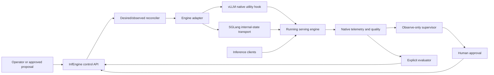

# InfEngine

Verified runtime control and workload evaluation for **patched vLLM 0.28.0** and **patched SGLang 0.5.18**.

InfEngine gives inference engineers a governed way to inspect supported runtime policies, change them within native bounds, verify their application, compare workload effects and restore recorded settings. It does not know the optimal configuration for every workload. A throughput gain can cost first-token latency, and a control that works correctly can be ineffective when another constraint dominates.

**Release status: research/pilot implementation, version 0.1.0.** Live acceptance covers the versions and single-GPU envelope described below. This is not production certification or unattended optimization. The code includes a small reference inference engine for development; deployed inference traffic goes directly to vLLM or SGLang.

Read the engineering article at [Puristan](https://puristan.com/posts/infengine-runtime-control/), the [control reference](docs/CONTROL_REFERENCE.md), [deployment instructions](docs/DEPLOYMENT.md) and [architecture](docs/ARCHITECTURE.md).

## Supported runtime controls

These are the initial validated controls, not an architectural ceiling. No additional actuator is implied to be implemented.

| vLLM HOT control | Native mapping and purpose | Bounds and evidence |
|---|---|---|
| `runtime_concurrency` | `scheduler.max_num_running_reqs`; upper bound on running admissions | Integer 1 through provisioned `max_num_seqs`; native acceptance; selected A100 A/B and factorial measurements |
| `runtime_max_scheduled_tokens` | `scheduler.max_num_scheduled_tokens`; total scheduled tokens in a step, prefill plus decode | Integer 1 through provisioned scheduled-token ceiling; native acceptance; A100 A/B and factorial measurements |
| `long_prefill_token_threshold` | `scheduler_config.long_prefill_token_threshold`; per-prompt prefill restriction for a long prompt in a step | Nonnegative integer; zero disables this restriction; native acceptance and one A100 A/B comparison |
| `runtime_kv_watermark` | `scheduler.kv_cache_manager.watermark_blocks`; reserves admission headroom as a fraction of existing blocks | Float in `[0.0, 1.0)`, exclusive upper bound; native acceptance, no A100 performance characterization |
| `runtime_reserve_full_isl` | `scheduler.scheduler_reserve_full_isl`; full-input versus first-chunk admission reservation | Boolean; future admissions only; native acceptance, no A100 performance characterization |

| SGLang HOT control | Native mapping and purpose | Bounds and evidence |
|---|---|---|
| `runtime_concurrency` | `pp_max_micro_batch_size`; per-rank admission ceiling, also constrained by request-token pool slots | Integer 1 through provisioned `max_running_requests` for proven PP=1/DP=1; native acceptance, no A100 performance study |
| `runtime_max_prefill_tokens` | Scheduler-local prefill input-admission budget | Integer 1 through provisioned `max_prefill_tokens`; native acceptance, no A100 performance study |

SGLang's prefill budget has a **first-request exception**. It is not a strict per-request cap or an equivalent of vLLM's total-step budget. `runtime_concurrency` is an operator alias for internal `runtime_max_running_seqs`; it is not an extra actuator.

These settings change scheduler/admission policy inside provisioned resources. They do not reload the model, resize KV pools or change CUDA graph provisioning. Cache resets are separate one-shot operations: the vLLM HTTP transport does not expose its in-process DRAIN/reset path; SGLang engine flush requires existing idleness and returns BLOCKED when busy. SGLang `prefix_cache_reset` is unsupported.

Native implementation, live verification, measured performance effect and benefit for an operational objective are different claims. Individual acceptance exists for all seven settings; performance evidence does not cover all seven.

## Architecture



Manual changes, approved proposals and explicitly launched evaluation phases use the same reconciliation path. Policies are prevalidated, revision-bound and verified by native readback. vLLM uses a coordinated multi-field request; SGLang applies fields sequentially. Neither has an engine-atomic guarantee. Compensation and restoration have explicit outcomes and can fail; restoring settings does not undo completed requests or cache history.

The supervisor proposes changes but cannot authorize its own mutations. Authenticated roles distinguish viewers, operators and approvers. SQLite audit history records actor, revision, requested policy, pre/post state, verification and recovery. The evaluator temporarily changes baseline/candidate policies and attempts original-state restoration; it never automatically deploys a winner.

## Prerequisites and installation

- Python 3.11 is the recommended release-check environment. Package metadata retains the implementation's minimum Python 3.9 declaration; other Python versions were not freshly qualified for this release.
- The host control plane needs the dependencies declared in `pyproject.toml`. It does not need to run model generation on a GPU.
- Live integrations need Docker/WSL2 or a suitable Linux NVIDIA environment, NVIDIA container support, and one compatible GPU with enough free memory for the chosen model and execution configuration.
- Recorded functional acceptance used a 4 GiB Quadro T2000 and a small Qwen model; recorded performance measurements used one A100 80 GB PCIe and Qwen2.5-7B-Instruct. These are different evidence scopes, not universal memory requirements.
- Engine compatibility is pinned to patched **vLLM 0.28.0** and **SGLang 0.5.18**, with SGLang PP=1, DP=1, text/token serving. Other engine versions, speculative/disaggregated modes and distributed coordination are not validated.

```bash
git clone https://github.com/yasiral/InfEngine.git
cd InfEngine
python -m venv .venv
source .venv/bin/activate
python -m pip install -e ".[dev,serve,eval]"
infengine version
```

On Windows, activate with `.venv\Scripts\Activate.ps1`. Engine containers need an existing GPU; the following deployment commands build images and may download upstream images/model weights. They are instructions, not work performed by the release process.

## Launch the supported vLLM deployment

Use a trusted local host and keep administrative ports on loopback. Generate separate engine-hop and operator credentials in the shell; do not commit them:

```bash
export INFENGINE_VLLM_CONTROL_TOKEN="$(python -c 'import secrets; print(secrets.token_urlsafe(32))')"
export INFENGINE_TOKEN="$(python -c 'import secrets; print(secrets.token_urlsafe(32))')"
export INFENGINE_AUTH_TOKENS="$(python -c 'import json,os; print(json.dumps({os.environ["INFENGINE_TOKEN"]:{"actor":"local-operator","role":"OPERATOR"}}))')"
export INFENGINE_VLLM_CONTROL_URL=http://127.0.0.1:9001
export INFENGINE_CONTROL_URL=http://127.0.0.1:8010

docker build -f contrib/vllm/Dockerfile.infengine \
  -t infengine-vllm:0.1.0-vllm0.28.0 .
docker run -d --name infengine_vllm --gpus all --ipc=host \
  -p 127.0.0.1:8000:8000 -p 127.0.0.1:9001:9001 \
  -e INFENGINE_CONTROL_PORT=9001 \
  -e INFENGINE_CONTROL_TOKEN="$INFENGINE_VLLM_CONTROL_TOKEN" \
  -v infengine_hf:/root/.cache/huggingface \
  infengine-vllm:0.1.0-vllm0.28.0 \
  --model Qwen/Qwen2.5-0.5B-Instruct --port 8000 \
  --enforce-eager --max-model-len 2048 \
  --gpu-memory-utilization 0.55 --max-num-seqs 64

infengine serve --runtime vllm \
  --vllm-control-url "$INFENGINE_VLLM_CONTROL_URL" \
  --state-file ./desired.json --audit-file ./audit.db \
  --host 127.0.0.1 --port 8010
```

The final command stays in the foreground. Run the next commands in another shell configured with the same control URL and operator credential, supplied through your environment/secret manager. Ports 8000 (inference), 9001 (native hook) and 8010 (InfEngine) have different jobs. The image bakes in the hook and a fail-closed compatibility check; it is a reproducible Docker definition, not a prepublished image registry artifact.

For SGLang, use the separate build and run commands in [DEPLOYMENT.md](docs/DEPLOYMENT.md). Its integration reuses native `set_internal_state` transport and adds only the scheduler-local prefill hook. Do not apply the vLLM token policy or image assumptions to SGLang.

## Inspect, apply, verify and restore

```bash
infengine doctor
infengine inspect --json
infengine capabilities --supported-only
infengine explain runtime_concurrency
```

`doctor` does not make telemetry a readiness gate. Check metric availability separately before relying on performance reports or latency guardrails.

Capture the actual desired-state revision rather than copying an example integer:

```bash
REVISION="$(infengine inspect --json | python -c 'import json,sys; print(json.load(sys.stdin)["revision"])')"
infengine apply examples/policy-multi.yaml --if-match "$REVISION" --dry-run
infengine apply examples/policy-multi.yaml --if-match "$REVISION"
infengine inspect --json
infengine history --limit 5

REVISION="$(infengine inspect --json | python -c 'import json,sys; print(json.load(sys.stdin)["revision"])')"
infengine restore --if-match "$REVISION"
infengine inspect --json
```

The example policy is for the documented vLLM provisioning; inspect live bounds before using it elsewhere. A dry run does not reserve the revision. On conflict, inspect the new state and reconsider rather than removing the condition. CONVERGED means verified native values, not improved performance. Restore is a new conditional action using recorded pre-state and must itself be verified.

Human review is separate from direct operator mutation. An appropriately authenticated approver can use `infengine review examples/policy-multi.yaml`; the whole policy, revision, expiry and fresh pre-state are bound to the reviewed proposal. See [RECIPES.md](docs/RECIPES.md) for role and workflow details.

## Evaluate a candidate policy

An evaluation is an intentional authorization for temporary policy changes on an engine you control:

```bash
infengine evaluate examples/evaluation-multi.yaml \
  --engine-url http://127.0.0.1:8000 --report evaluation.html
```

The YAML defines full baseline/candidate maps, workload, warmup, repetitions and measurement requirements. Before evaluation, the desired state must contain the controls to restore; the evaluator rejects a phase it cannot safely preflight. Inspect per-control verification, missing fields, unfinished/drained requests and restore results before reading the trade-off label. An unavailable metric is not zero or proof of equivalence. A `finally` path guarantees an attempt, not successful restoration under every failure.

## Tests

```bash
python -m pytest -q -m "not integration"
```

These tests use fakes and the built-in/reference engine. Live integration tests are separately marked and opt-in through `VLLM_INTEGRATION=1` or `SGLANG_INTEGRATION=1`, requiring the corresponding patched engine/GPU. Do not enable them against a shared service without authorizing workload and mutations. See [release verification](docs/RELEASE_VERIFICATION.md) for the fresh local result and tests not run.

## Limitations and source layout

The pilot has no fleet-wide control guarantee, no cross-engine performance ranking and no universal best settings. Desired-state, revision and audit persistence are separate stores; this is not a distributed, crash-atomic transaction system. Pending approvals have a separate process lifecycle. Remote use needs authentication, protected native admin endpoints and externally terminated TLS. Engine atomicity, successful compensation and latency availability must not be inferred from a successful API response.

| Path | Purpose |
|---|---|
| `src/infengine/control/` | Capability contract, desired/observed state and reconciler |
| `src/infengine/vllm/`, `sglang/` | Native adapters and readback transports |
| `src/infengine/supervisor/` | Observe-only policy, human approval and assessment |
| `src/infengine/telemetry/` | Native collectors, windows, quality and histogram semantics |
| `src/infengine/unified.py`, `serve.py`, `experiment.py` | CLI, control API and evaluation |
| `contrib/` | Engine patches, listener, compatibility gate and Docker build definitions |
| `examples/` | Policy and evaluation YAML |
| `tests/` | Unit, local API and opt-in live integration tests |

Original development history, private experimental environments, raw archives, caches and model weights are not part of this public release. Measured article findings remain scoped to their documented experiments.

## License

InfEngine's own code is released under [Apache-2.0](LICENSE). Engine patches retain upstream attributions and Apache-2.0 terms; see [NOTICE](NOTICE) and [third-party details](THIRD_PARTY_NOTICES.md). Upstream engines, downloaded dependencies, container contents and model weights keep their own licenses. This repository does not relicense them or grant model-distribution rights.
