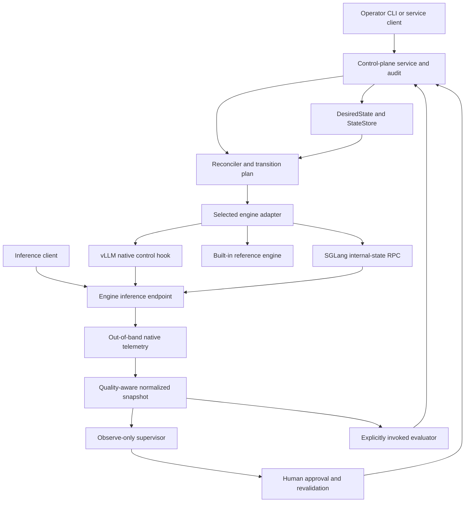
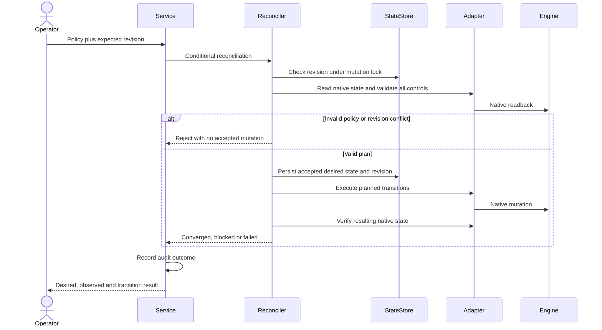
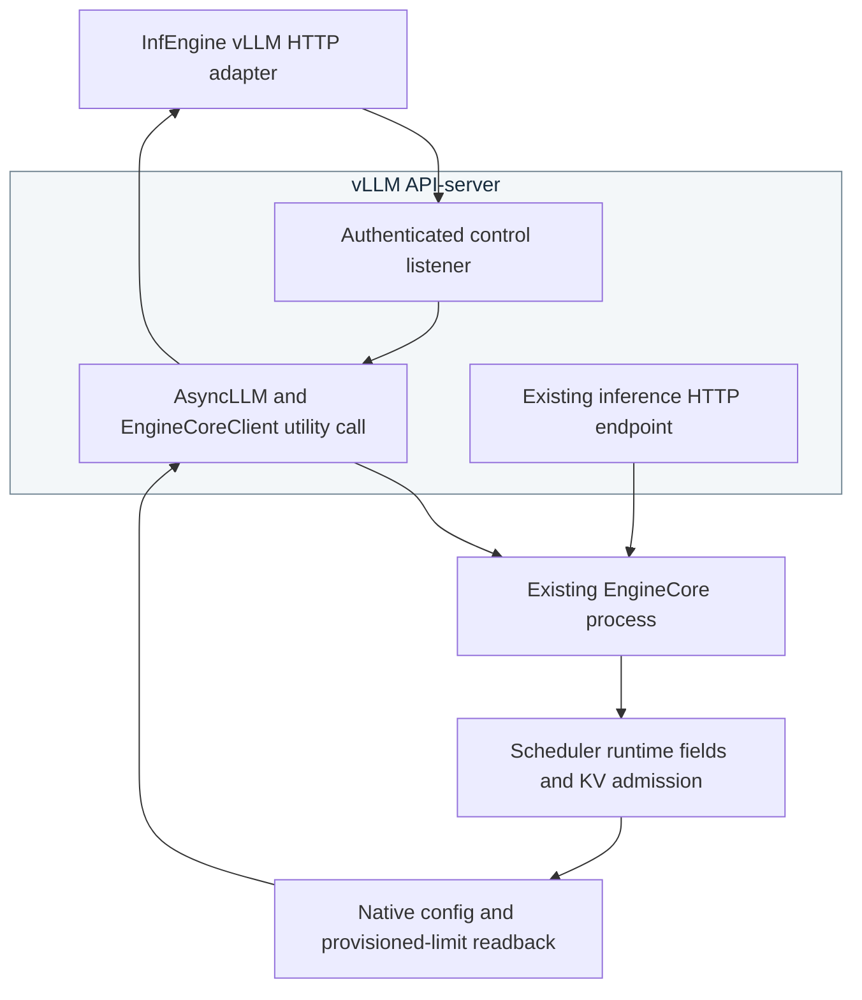
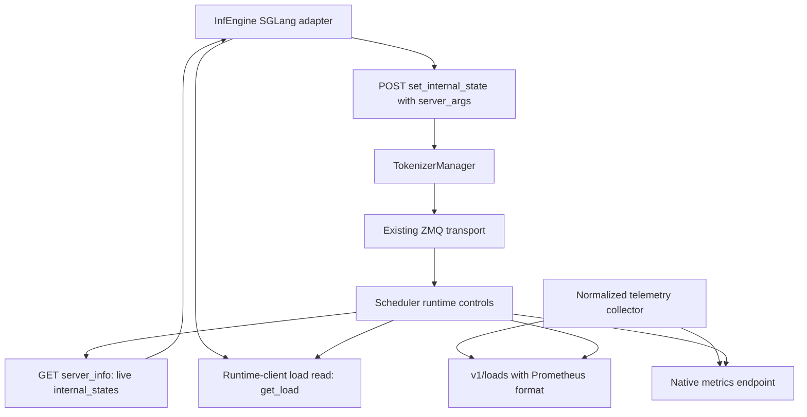
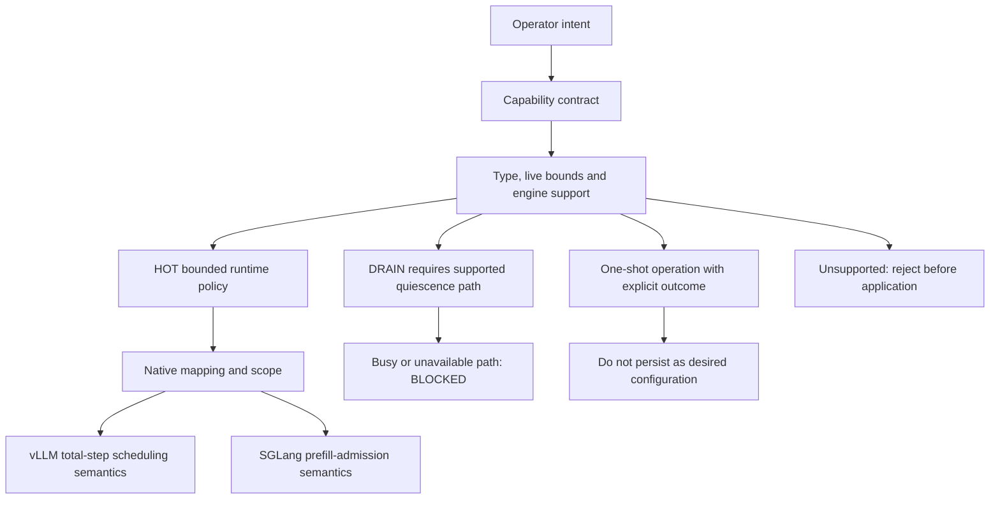
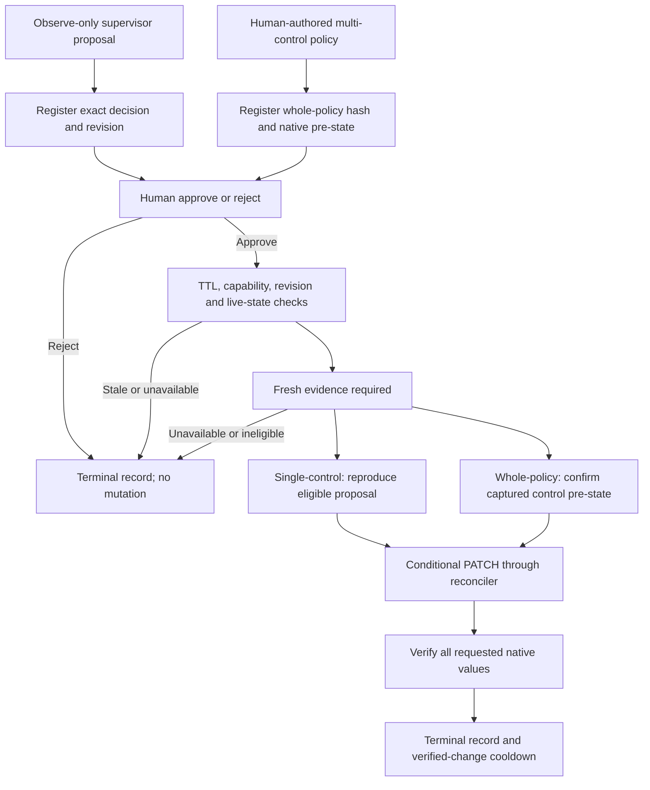
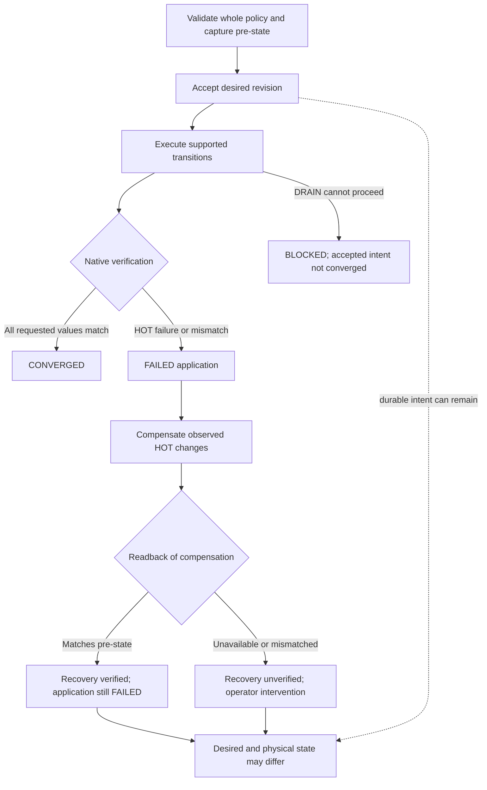
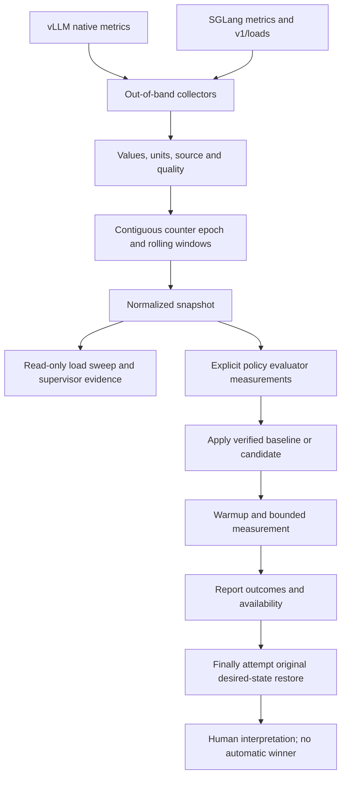
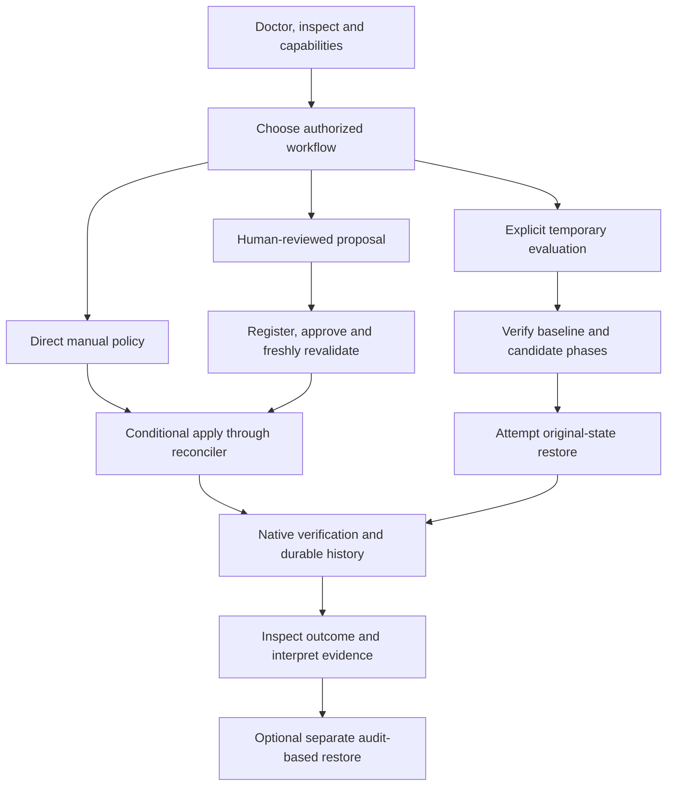

# Architecture and engineering diagrams

These nine Mermaid sources explain the system, native control paths and engineering workflow. They are architectural documentation, not measured performance results. For the simpler introduction, keep using the three diagrams in the main README.

## System architecture

[Mermaid source](diagrams/d01_system_architecture.mmd)

## Reconciliation sequence

[Mermaid source](diagrams/d02_reconciliation_sequence.mmd)

## vLLM control path

[Mermaid source](diagrams/d03_vllm_control_path.mmd)

## SGLang control path

[Mermaid source](diagrams/d04_sglang_control_path.mmd)

## Capability semantics

[Mermaid source](diagrams/d05_capability_semantics.mmd)

## Approval lifecycle

[Mermaid source](diagrams/d06_approval_lifecycle.mmd)

## Multi control failure recovery

[Mermaid source](diagrams/d07_multi_control_failure_recovery.mmd)

## Evaluation telemetry lifecycle

[Mermaid source](diagrams/d08_evaluation_telemetry_lifecycle.mmd)

## Operator workflow

[Mermaid source](diagrams/d10_operator_workflow.mmd)

