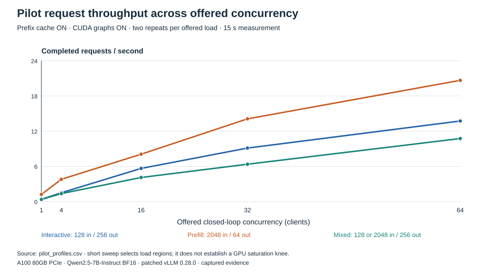
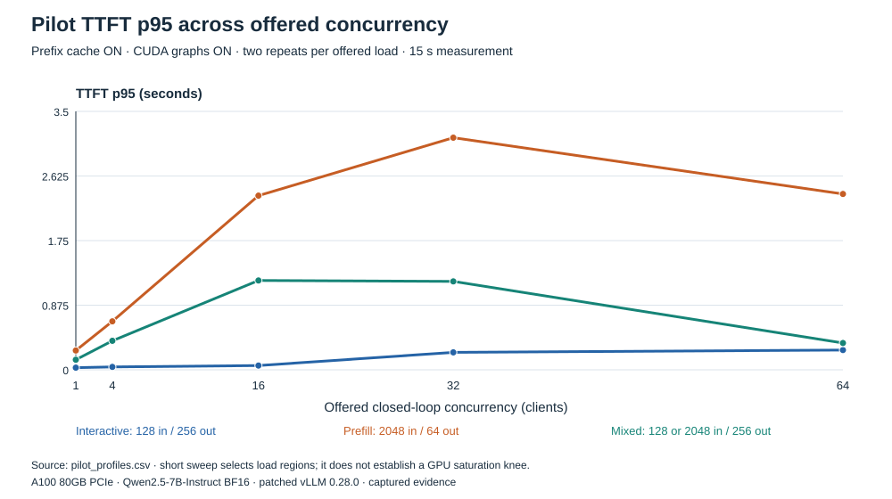
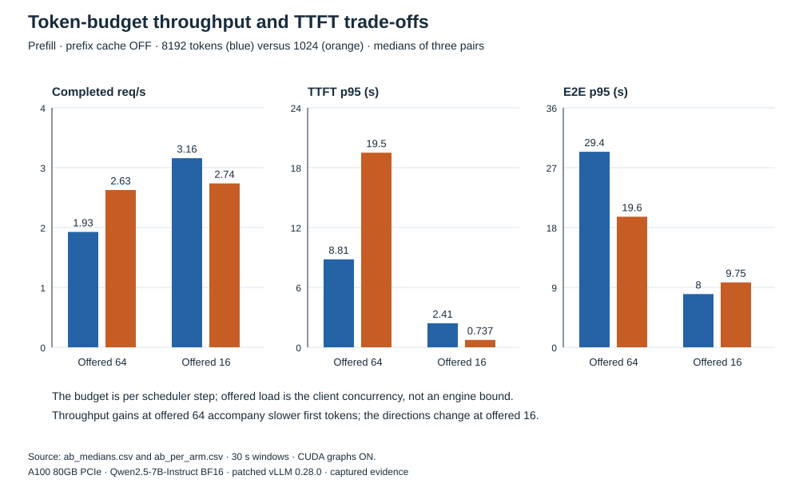
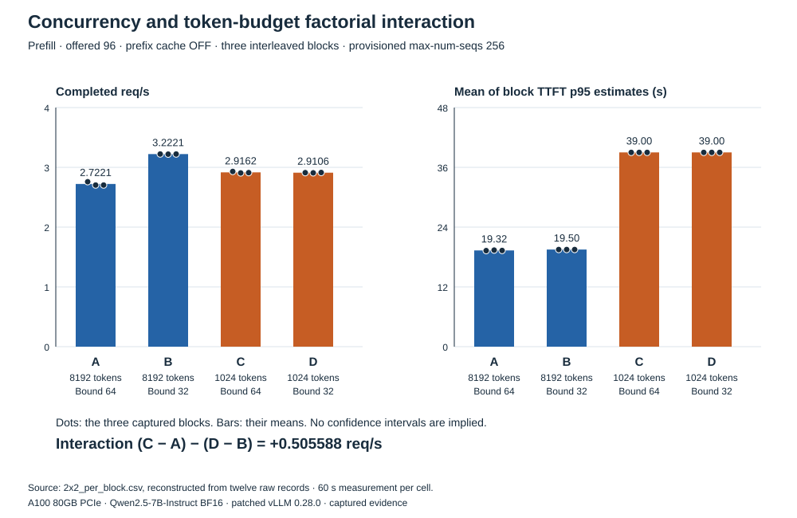
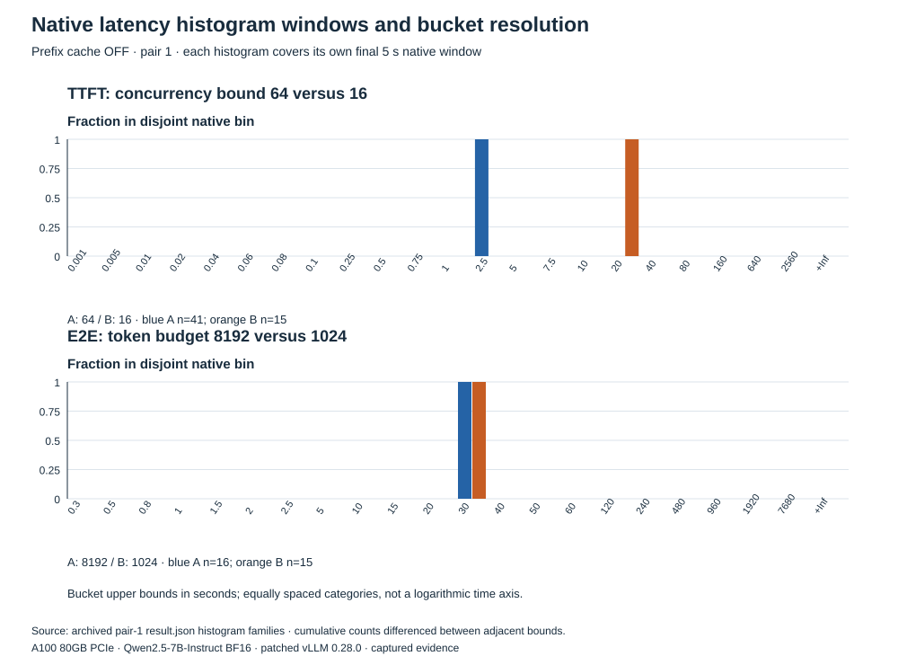
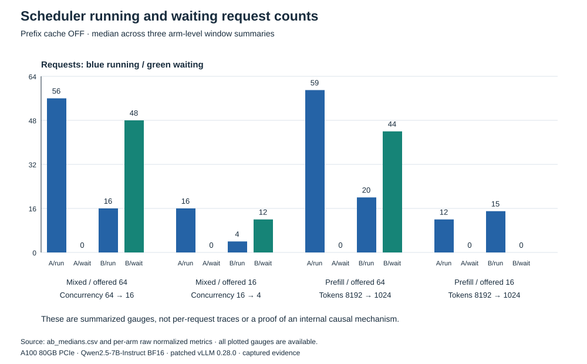
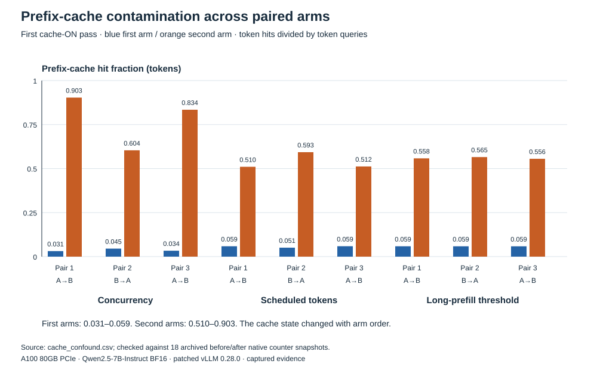
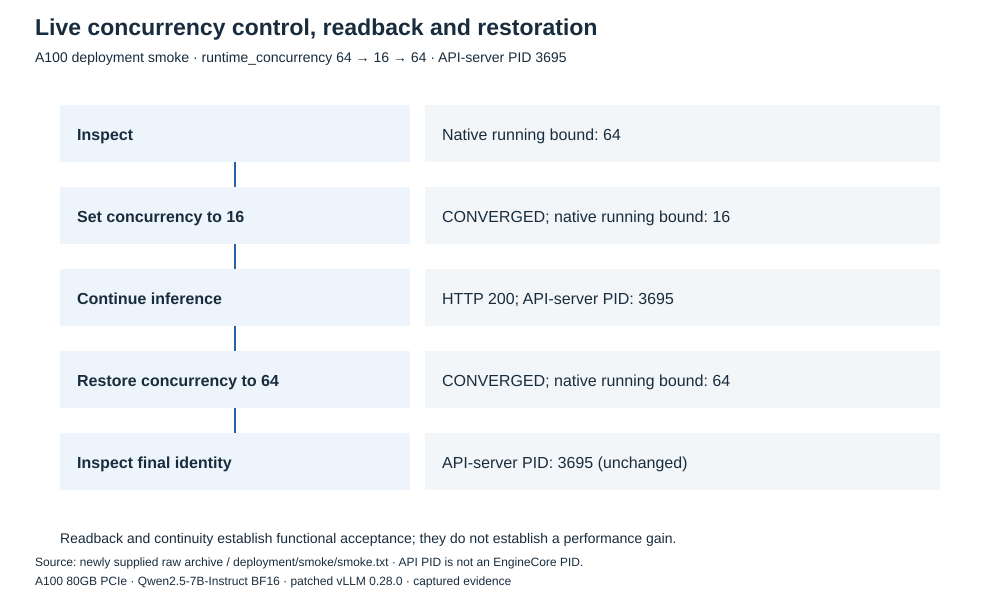

# Experimental figure gallery and manifest

The eight SVGs below preserve the published article assets. Reproduction scripts create separate renderings with corrected technical headings and narrower smoke wording. All performance figures concern the same A100/model/vLLM study; each experiment has its own cache, load and window settings.

## 1. Pilot request throughput across offered concurrency

**Source:** pilot_profiles.csv. **Interpretation:** Two-repeat medians, 15-second windows, cache enabled; no proven saturation knee.

## 2. Pilot TTFT p95 across offered concurrency

**Source:** pilot_profiles.csv. **Interpretation:** Same initial pilot; quantile summaries, not pooled percentiles.

## 3. Token-budget throughput and TTFT trade-offs

**Source:** ab_medians.csv; ab_per_arm.csv. **Interpretation:** Marginal medians of three arms per condition; paired-ratio estimates are a separate statistic.

## 4. Concurrency and token-budget factorial interaction

**Source:** 2x2_per_block.csv; 2x2_summary.json. **Interpretation:** Three interleaved blocks, offered concurrency 96, 60 seconds/cell, cache disabled; means of block quantile estimates.

## 5. Native latency histogram windows and bucket resolution

**Source:** pair-1 result.json histogram families. **Interpretation:** Each arm's own final five-second window; cumulative buckets must be differenced; TTFT n=41/15 and E2E n=16/15.

## 6. Scheduler running and waiting request counts

**Source:** ab_medians.csv; ab_per_arm.csv. **Interpretation:** Medians of available window summaries; no per-request tracing or causal proof.

## 7. Prefix-cache contamination across paired arms

**Source:** cache_confound.csv; native cache counter extracts. **Interpretation:** Nine ordered pairs, 18 native token counter deltas; this is a confound, not a speedup.

## 8. Live concurrency control, readback and restoration

**Source:** deployment/smoke/smoke.json. **Interpretation:** Functional readback/restore, unchanged API PID. Historical HTTP 200 label is reported; no explicit status line in transcript.
